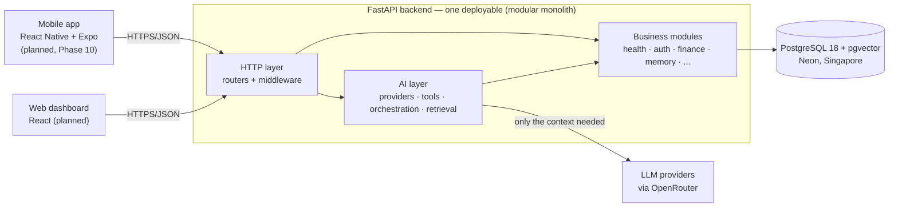
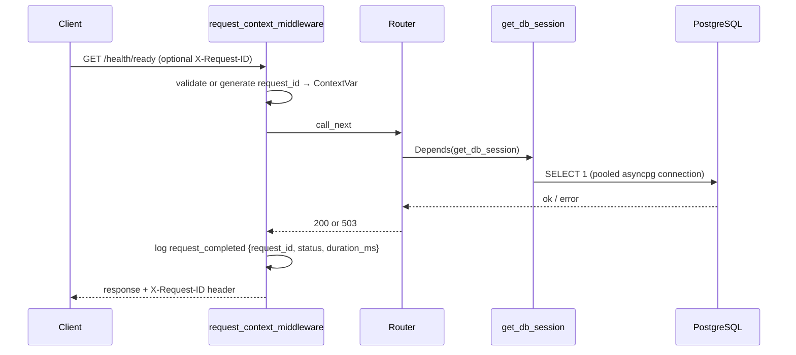
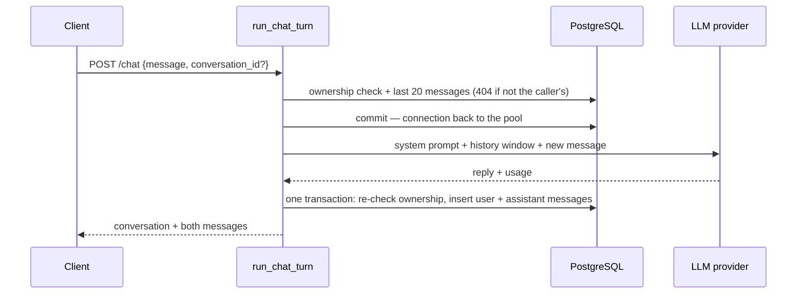

# LifePilot AI — Architecture

Status: Phase 1 (Foundation) and Phase 2 (Authentication) complete. Sections marked **planned** describe agreed design that is not built yet.

## 1. Product loop

Every feature serves the same loop:

```
UNDERSTAND → REMEMBER → RETRIEVE → DECIDE → EXECUTE → VERIFY
```

The LLM is used to *understand* language and *decide* which action to take. Facts are
*remembered* and *retrieved* from PostgreSQL, never from the model's own memory, and every
action is *executed* by validated backend code and *verified* afterwards.

## 2. System overview



Why a modular monolith: AI tools must call business services, share the request's database
session and transaction, and know the authenticated user. In one process that is a function
call. Split out a component (e.g. an embedding worker) only when it has measurably different
runtime needs.

## 3. Web app (apps/web)

Vite + React 19 + TypeScript (strict) + Tailwind CSS 4 + React Router. A single-page app that
talks only to the FastAPI backend; no server of its own.

```
apps/web/src/
├── api/types.ts       API contract (snake_case, mirrors Pydantic; later generated from OpenAPI)
├── api/client.ts      mock data for screens whose backend isn't built yet (dashboard, finance)
├── api/mock.ts        sample data matching the approved design
├── api/http.ts        apiFetch: access token, one refresh-and-retry on 401, ApiError
├── api/auth.ts, chat.ts  real backend calls, added per phase
├── lib/               formatting (money, dates), useApi hook
├── components/        layout (AppShell, collapsible Sidebar) and ui (Card, StatCard, ...)
├── theme/             light/dark/system mode + accent presets, ThemeProvider, useAppearance
└── features/<area>/   one folder per screen: dashboard, assistant, finance, settings
```

Assistant (`features/assistant/`, Phase 3.2): routes `/assistant` (new chat) and
`/assistant/:conversationId`. `ConversationsProvider` (in `AppShell`) loads the chat list once
for the sidebar and the page. A new chat's first messages are handed to the new URL in
navigation state (then cleared, so a reload refetches). Failed sends show **Retry** and keep
the text. Replies render through `Markdown.tsx` (`react-markdown`): model output is untrusted,
so raw HTML is shown as text and `javascript:` links are stripped, verified by an E2E test that
injects a hostile reply. `ActionCards.tsx` holds the tool-result and approval cards for 3.5.

Rules:

- Pages never import `mock.ts` or call `fetch` directly; they use the `api/*` modules.
- Money arrives as decimal strings and is only formatted for display, never summed in the
  browser. Totals such as `net` come from the backend.
- Components use only semantic colour classes (`bg-surface`, `text-muted`, `bg-accent`,
  `text-on-accent`), never raw hex or `text-white` on an accent, so they work in both themes.

### Theming

- `src/index.css` defines every colour twice as `--lp-*` variables: light under `:root`, dark
  under `:root[data-theme="dark"]`. `@theme inline` maps them to Tailwind colour names.
- Settings stores `{mode, accent}` in `localStorage` (`lifepilot.appearance`). `theme.ts`
  resolves `system` from `prefers-color-scheme` and writes `data-theme` plus the accent
  variables onto `<html>`.
- Accents are presets, each with a light and dark shade checked for ≥4.5:1 contrast; there is
  no free colour picker, so an unreadable combination cannot be chosen.
- An inline script in `index.html` sets `data-theme` before first paint to avoid a light flash
  for dark-mode users.

## 4. Backend layers and the dependency rule

```
backend/app/
├── main.py          app factory: logging, middleware, error handlers, routers, lifespan
├── core/            cross-cutting: config, logging, errors, middleware
├── db/              engine, sessions, declarative Base
├── modules/<name>/  business domains — models.py, schemas.py, service.py, router.py
└── ai/              LLM-facing code (planned: providers, prompts, tools, orchestration, retrieval)
```

Allowed imports (arrows point at what may be imported):

```
main ──► modules, ai, core, db
ai ────► modules, core, db
modules ► core, db
core, db ► (nothing in app except core.config)
```

**`modules` must never import from `ai`.** Business logic must work identically whether it is
called from the chat assistant, a mobile form, or a test. The LLM is a client of the business
logic, not part of it.

Inside a module:

| File | Responsibility |
|---|---|
| `router.py` | HTTP only: parse request, call service, shape response |
| `schemas.py` | Pydantic request/response models (the API contract) |
| `service.py` | Business rules and DB access; the only thing AI tools may call |
| `models.py` | SQLAlchemy tables |

## 5. Request lifecycle (current)



Every log line written during the request carries the same `request_id`, so one request can be
traced end to end. Later this will also cover LLM calls and tool executions.

## 6. AI layer (Phase 3)

### LLM providers (Phase 3.1)

```
app/ai/providers/
├── base.py        LLMProvider protocol + neutral types: ChatMessage, ToolCall, ToolSpec,
│                  ResponseSchema, ChatResult, Usage; error classes LLM*Error
├── openrouter.py  OpenRouterProvider (httpx, OpenAI-compatible /chat/completions)
├── fake.py        FakeProvider: scripted replies, records calls (tests, offline)
└── factory.py     get_llm_provider() from settings; closed on app shutdown
app/ai/cli.py      python -m app.ai.cli "question": one call, prints tokens / cost / latency
```

- Only `app/ai/providers` knows any vendor's wire format. Adding a direct Anthropic provider
  (official SDK) later means one new class behind the same protocol.
- Model: `LLM_MODEL` (default `anthropic/claude-opus-5.5`, $4 / $20 per 1M tokens in/out).
  Cheaper options: `anthropic/claude-sonnet-5.5`, `anthropic/claude-haiku-5.5`. Choose by eval
  results (Phase 9), not by guess.
- No `temperature`/`top_p`/`top_k` are sent: current Claude models reject sampling parameters.
- Retries: only 429, 5xx, timeouts and connection errors; exponential backoff with full jitter,
  `Retry-After` honoured (max 30 s); `LLM_MAX_RETRIES` (default 2). 400/401/402/404 fail fast.
- Errors: `LLMAuthError` (401/403), `LLMQuotaError` (402), `LLMBadRequestError`,
  `LLMRateLimitError`, `LLMUnavailableError`. OpenRouter errors inside HTTP 200 are detected.
- Observability: one `llm_call` log line per call with model, tokens, cost, latency, finish
  reason, attempts. Message content is never logged.
- Tests use `LLM_PROVIDER=fake` and `httpx.MockTransport`; no test calls a real model.

### Chat and conversations (Phase 3.2)

```
app/modules/conversations/   storage only (no LLM code): Conversation, Message, ownership-checked service
app/ai/prompts/system.py     system prompt + PROMPT_VERSION (stored on every assistant message)
app/ai/chat/context.py       build_messages(): system prompt + recent history window + new message
app/ai/chat/service.py       run_chat_turn(): load history → release DB connection → LLM → store turn
app/ai/chat/router.py        POST /api/v1/chat
```

API: `POST /chat {message, conversation_id?}` (omit the id to start a conversation),
`GET /conversations`, `GET /conversations/{id}` (with messages), `DELETE /conversations/{id}`.



- **LLMs are stateless.** Chat memory is the history we resend each turn, so it costs input tokens
  every time. The window is the last 20 messages and at most ~24k characters (~6k tokens), trimmed
  oldest-first and never starting on an assistant reply.
- **No DB connection is held during the model call** (seconds long; the pool has 5 connections).
  Tested by checking `engine.pool.checkedout() == 0` inside the provider call.
- **A turn is all-or-nothing.** Nothing is written until the model has answered; LLM errors and
  empty replies store nothing. Retryable provider errors → `503 assistant_unavailable`, others →
  `502 assistant_failed`, with no provider details in the response.
- **Isolation.** `messages.user_id` duplicates the conversation's owner so every query filters on
  it directly. Another user's conversation returns the same 404 as a non-existent id, and is
  rejected before any tokens are spent.
- **Traceability.** Each assistant message stores model, prompt version, tokens, cost
  (`NUMERIC(12,8)`, returned as a fixed-point string), latency and finish reason.
- **Data minimisation.** The system prompt carries no name, email or profile data. Titles are the
  first 60 characters of the opening message (no extra LLM call).
- Until tools exist (3.5), the prompt forbids claiming that anything was saved or looked up.

## 7. Planned AI request flow (Phase 3–4)

Example: *"I spent ₹250 on food"*.

```
POST /chat
 → auth: resolve current user                         core/ (Phase 2)
 → LLM call with tool definitions                     ai/providers, ai/prompts
 → model returns structured tool call:
     log_expense {amount: 250, currency: INR, category: "food"}
 → validate arguments with Pydantic                    ai/tools
 → permission check (+ user approval if sensitive)     ai/guardrails
 → finance service.create_expense(db, user_id, ...)    modules/finance/service.py
 → commit transaction
 → VERIFY: read the row back                           ai/orchestration
 → reply to user based on the verified result
```

For questions like *"When did I last get a haircut?"*, structured facts are answered with a
deterministic SQL query through a service function. Semantic search (pgvector) is used only for
fuzzy recall over free text such as notes and documents, never as a substitute for a relational
query.

## 8. Data

- **PostgreSQL** is the system of record. Money uses `NUMERIC`; every user-owned table has a
  `user_id` foreign key and every query filters on it.
- **pgvector** is enabled by the first migration; vector columns will live next to the rows they
  describe, so a semantic query can also filter by `user_id` and date in the same SQL statement.
- **Alembic** owns all schema changes. Never change the schema by hand in the Neon console.
- **Redis** is not used yet; it will be added only when caching or background jobs need it.

## 9. Configuration and environments

| Concern | Decision |
|---|---|
| Settings | `pydantic-settings`, read from the repo-root `.env`; app fails fast if required values are missing |
| Secrets | `SecretStr`, never logged; `.env` is git-ignored; `.env.example` is the committed template |
| Database URL | Neon's libpq URL is normalised to `postgresql+asyncpg://…?ssl=…` in `core/config.py` |
| Connection | Direct (unpooled) Neon endpoint; SQLAlchemy pool with `pool_pre_ping` for Neon's scale-to-zero |
| Hosting | Neon project `lifepilot`, region `aws-ap-southeast-1` (Singapore), branch `main` |
| Tests | Schema-only Neon branch `test` via `TEST_DATABASE_URL`; rebuilt from migrations each run; config refuses a test URL equal to the main one |

## 10. Cross-cutting conventions

**Error response** — every non-2xx response except health checks:

```json
{"error": {"code": "not_found", "message": "Not Found", "request_id": "…", "details": []}}
```

- Services raise `AppError` subclasses for expected failures.
- Unhandled exceptions return a generic `internal_error`; the traceback goes only to logs.
- Validation errors list the failing fields but never echo submitted values.

**Logging** — one JSON object per line on stdout with `ts`, `level`, `logger`, `message`,
`request_id` and any `extra=` fields. Third-party per-request logs (uvicorn access, httpx) are
suppressed.

**Health**

- `GET /health` is liveness and never touches dependencies.
- `GET /health/ready` is readiness and requires a DB round trip (200 or 503).

## 11. Security principles

1. The LLM never writes or executes SQL; it can only request tools, which call validated services.
2. Every user-owned query is scoped by the authenticated `user_id`.
3. Sensitive actions require explicit user approval; important actions are audit-logged.
4. Send the LLM only the minimum personal data the task needs.
5. Retrieved documents are treated as untrusted input (prompt-injection defence).
6. Passwords: Argon2id. Auth: JWT. See Authentication below.

### Authentication (Phase 2)

| Endpoint | Auth | Result |
|---|---|---|
| `POST /api/v1/auth/register` | none | 201 user · 409 `email_taken` · 422 validation |
| `POST /api/v1/auth/login` | none | 200 `{access_token, token_type, expires_in}` · 401 `invalid_credentials` |
| `GET /api/v1/users/me` | Bearer | 200 user · 401 `not_authenticated` / `invalid_token` |
| `POST /api/v1/auth/refresh` | refresh cookie | 200 new access token + rotated cookie · 401 `invalid_refresh_token` |
| `POST /api/v1/auth/logout` | refresh cookie | 204, session family revoked, cookie cleared (idempotent) |

**Web sessions (2b).** Login also sets `lp_refresh`: an opaque 256-bit token in an
`HttpOnly; Secure; SameSite=Strict; Path=/api/v1/auth` cookie, valid 30 days
(`REFRESH_TOKEN_EXPIRE_DAYS`). Only its SHA-256 is stored, in `refresh_sessions`.

- *Rotation*: each refresh atomically claims the token (`UPDATE … WHERE used_at IS NULL …
  RETURNING`) and issues a successor in the same `family_id`. Exactly one of two concurrent
  refreshes can win.
- *Reuse detection*: presenting an already-used token revokes the whole family (logged as
  `refresh_token_reuse_detected`); the legitimate user signs in again.
- *Web app*: the access token lives only in memory; on load the app calls `/auth/refresh` to
  restore the session. Refreshes are single-flight per tab and serialised across tabs with a
  Web Lock, so the user's own tabs never trigger reuse detection.
- *Dev topology*: Vite proxies `/api` to FastAPI, so browser, cookie and API share one origin
  (no CORS). Production must keep the API same-site with the web app.
- Expired and revoked rows are not yet purged; add a scheduled cleanup with the worker setup.

**Sign in with Google (2c).** OpenID Connect authorization-code flow with PKCE, in
`modules/auth/google.py` + `google_router.py`, on top of PyJWT (no OAuth framework).

| Endpoint | Purpose |
|---|---|
| `GET /api/v1/auth/google/start?next=/path` | Sets the signed 10-min `lp_oauth` cookie (state, PKCE verifier, nonce, next) and redirects to Google |
| `GET /api/v1/auth/google/callback` | Checks state, exchanges code + verifier, verifies the ID token, signs in, sets `lp_refresh`, redirects to `WEB_APP_URL` + next; any failure redirects to `/login?error=<code>` |

- `lp_oauth` is `SameSite=Lax` (Strict would not be sent on the navigation back from Google)
  and `Path=/api/v1/auth/google`; it is deleted on every callback.
- ID token: RS256 signature against Google's JWKS (`PyJWKClient`, keys cached 1 h), `aud` = our
  client id, `iss` = Google, `exp`/`iat` (30 s leeway), `nonce` = ours.
- Account resolution: by `oauth_identities(provider, subject)` first, never by email alone.
  New identities need `email_verified`; a matching email then links, otherwise a new
  passwordless user is created.
- **Pre-account hijacking defence**: linking to an account whose email was never verified removes
  its password and revokes its sessions (log `unverified_account_claimed_via_google`), so
  whoever registered the address first loses access. Password signups are unverified until
  an email-verification flow exists.
- Google-only users have `password_hash = NULL`; password login for them fails exactly like a
  wrong password. The migration's downgrade refuses while such users exist.
- `next` is accepted only as an in-app path (`/…`, not `//…`, no backslash).
- Error codes for the login page: `google_cancelled`, `google_failed`,
  `google_email_unverified`, `account_disabled`. Details go to the `google_sign_in_failed` log.

- **Passwords**: Argon2id via argon2-cffi (RFC 9106 low-memory profile), 12–128 characters,
  hashed in a worker thread so the event loop is never blocked. Hashes are upgraded on login
  when parameters change.
- **Tokens**: HS256 JWT signed with `JWT_SECRET_KEY` (≥32 chars, app refuses to start otherwise).
  Claims `sub` (user id), `type=access`, `iat`, `exp`, `jti`. Decoding pins the algorithm and
  requires all claims. Lifetime `ACCESS_TOKEN_EXPIRE_MINUTES` (default 30).
- **Login** returns one error for unknown email, wrong password and inactive account, and spends
  the same Argon2 time on unknown emails, so accounts cannot be enumerated through login.
  Registration does reveal that an email is taken (409): an accepted trade-off for usability.
- **Current user**: `CurrentUser` dependency verifies the token, then reloads the user, so a
  deleted or deactivated account loses access immediately, not when its token expires.
- **Users**: UUIDv7 ids (unguessable, index-friendly); emails stored lowercased, enforced by
  `ck_users_email_lowercase`; uniqueness enforced by `uq_users_email` (race-safe).
- **Data isolation rule**: every user-owned table gets a `user_id` foreign key, and every service
  function takes the `CurrentUser`'s id and filters on it. Tests for each such table must prove
  user A cannot read or change user B's rows.
- **Not yet built**: login rate limiting (with Redis), audit-log table (auth events are logged
  as structured log lines for now), "sign out everywhere" and a list of active sessions.

## 12. Roadmap

| Phase | Scope | Status |
|---|---|---|
| 1 | Foundation: FastAPI, Postgres, SQLAlchemy, Alembic, config, logging, health | Done |
| 2 | Authentication and user isolation | Done (refresh tokens, rate limiting pending) |
| 2b | Web sessions: refresh tokens in httpOnly cookies, rotation and revocation; web Login/Register screens | Done |
| 2c | Sign in with Google (OpenID Connect on PyJWT): state + PKCE + nonce, ID-token verification, `oauth_identities` table, nullable `password_hash`, pre-account-hijacking defence | Done |
| 3c | Google Workspace connector (Calendar, Gmail, Drive): incremental consent per scope, `access_type=offline`, refresh tokens encrypted at rest in `connected_accounts`, revoke on disconnect; Gmail scopes need Google verification before other users | — |
| 3 | AI assistant: provider abstraction (3.1 done), chat + conversations (3.2 done), streaming (3.3), structured outputs (3.4), tool calling with verification and approval (3.5) | In progress |
| 4 | Personal memory: extraction, storage, retrieval, semantic memory | — |
| 5 | Finance | — |
| 5b | Bank statement import: PDF upload → deterministic table parsing (LLM structured-output fallback) → balance reconciliation check → categorisation → user review → single-transaction import; idempotent per file hash and transaction fingerprint; account numbers and balances redacted before any LLM call | — |
| 6 | Study and career | — |
| 7 | Fitness | — |
| 8 | Document intelligence (RAG with citations) | — |
| 9 | Advanced AI: LangGraph where justified, evaluation, observability, guardrails | — |
| 10 | Frontend, deployment, CI/CD, monitoring | — |
